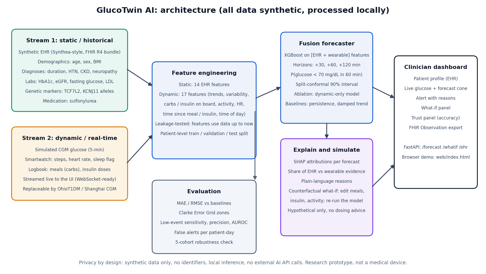
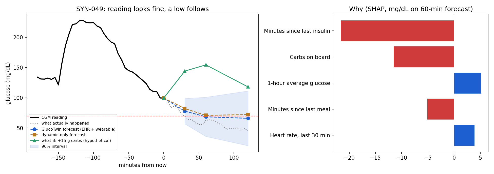

# GlucoTwin AI: Predictive Healthcare Digital Twin for Early Low-Glucose Warning

> Research prototype built for the Happiest Health "Reimagining and Reforming Healthcare in India" Summit 2026, Phase 1 (Prototype and Code Submission). It uses **synthetic data only** and is **not a medical device**.

## 1. Team and institute
| | |
|---|---|
| Team name | TriCode |
| Members | Anushka Aggarwal (team lead, ML and data), Anshu Yadav (backend and explainability), Aarti (frontend, UX and research) |
| College / incubator | Delhi Technological University *(confirm and edit if different)* |
| Team leader contact | Submitted on the submission platform only, as required |

## 2. Project title
**GlucoTwin AI**: a predictive digital twin that fuses a patient's health record with wearable glucose data to warn of a dangerous low-glucose event up to 2 hours ahead, explain why, and let a doctor test what-ifs.

## 3. Problem statement and healthcare use case
People with Type 2 diabetes, especially those on insulin or sulfonylureas, can drift into hypoglycaemia (below 70 mg/dL) without warning. Current apps show the present reading or alarm after a threshold is crossed. Doctors see snapshots between visits. **Use case:** predict a low-glucose event 30 to 120 minutes in advance from two fused data streams, show the reasons in plain language, and show uncertainty, so a clinician can trust and act on it. The tool is decision support and never recommends doses.

## 4. How the prototype meets the challenge brief
| Requirement | Where it is met |
|---|---|
| **Static / historical stream:** simulated EHR with demographics, diagnoses, labs, genetic markers | `glucotwin/ehr.py` generates 60 synthetic Type 2 diabetes patients: age, sex, BMI; diabetes duration, hypertension, neuropathy, CKD stage, sulfonylurea use; HbA1c, eGFR, fasting glucose, LDL; TCF7L2 and KCNJ11 risk-allele counts. Exports FHIR R4-style bundles (`results/example_fhir_bundle.json`). |
| **Dynamic / real-time stream:** wearable / IoT time series | `glucotwin/cgm.py` simulates 5-minute CGM glucose, steps, heart rate, sleep flag, plus meal and insulin logs. Browser demo streams it live. |
| **Fusion of both streams** | `glucotwin/features.py` joins 14 static + 17 dynamic features; `glucotwin/model.py` trains the fused forecaster and a dynamic-only ablation. |
| **Working model that predicts an adverse event** | Forecasts glucose at +30/60/120 min and P(low in 60 min), tested on **16 patients never seen in training**. |
| **Conceptual UI dashboard for a doctor** | `web/index.html` (open in any browser) and the FastAPI service `glucotwin/api.py`. |
| **Sandbox rules** | Synthetic data only; no real patient data, no external AI APIs; processing is local. |

## 5. Technical stack, AI/ML model and framework
- **Language and libraries:** Python 3.12, NumPy, pandas, SciPy, scikit-learn, **XGBoost** (gradient-boosted trees), **SHAP**, matplotlib, **FastAPI** + Uvicorn, pytest.
- **Dashboard:** single-file HTML/CSS/JavaScript (`web/index.html`) with an in-browser ridge-regression and small neural-network twin trained on the fly; reads CSV or generates a demo patient.
- **Model:** one XGBoost regressor per horizon (30, 60, 120 min) on glucose change, one XGBoost classifier for P(glucose < 70 at 60 min). Inputs are the fused static + dynamic feature table. Early stopping on validation patients.
- **Uncertainty:** split-conformal 90% intervals calibrated on validation patients (measured test coverage 90%).
- **Explainability:** SHAP per forecast, grouped by data stream, with plain-language sentences.
- **What-if:** edit the event log at "now" (add carbs, scale recent insulin, add walking), rebuild features, re-run the trained model. Labelled hypothetical.
- **Evaluation:** patient-level split (36 train / 8 validation / 16 test patients), baselines (persistence, damped linear trend), dynamic-only ablation, MAE/RMSE, Clarke Error Grid, low-event sensitivity/precision, AUROC.

## 6. Architecture diagram


PDF version: [`docs/architecture.pdf`](docs/architecture.pdf)

## 7. Results (from `python run_pipeline.py`)
| Model | MAE 30 | MAE 60 | MAE 120 | RMSE 60 | Clarke A+B 60 | Clarke D+E 60 | Low sens. 60 | Low prec. 60 | AUROC low 60 |
|---|---|---|---|---|---|---|---|---|---|
| Persistence (no change) | 19.7 | 34.1 | 51.5 | 47.6 | 93% | 7% | 55% | 55% | nan |
| Damped linear trend | 18.6 | 35.9 | 62.7 | 51.8 | 92% | 5% | 72% | 49% | nan |
| Dynamic-only XGBoost | 10.6 | 15.0 | 20.0 | 21.7 | 96% | 4% | 55% | 85% | 0.97 |
| GlucoTwin (EHR + wearable fusion) | 10.4 | 14.5 | 18.9 | 21.2 | 96% | 4% | 56% | 86% | 0.97 |

MAE in mg/dL on 16 unseen synthetic patients (63360 forecasts). Low-glucose event rate at 60 min in the test set: 10.2%.
Share of SHAP importance (60-min model): static EHR 9%, dynamic wearable 91%.

Alert rule P(low in 60 min) >= tau, tau tuned on validation patients for >=80% sensitivity:
- Dynamic-only XGBoost: tau 0.29, sensitivity 73%, precision 69%, false-alert readings per patient-day 9.4
- GlucoTwin (EHR + wearable fusion): tau 0.30, sensitivity 74%, precision 70%, false-alert readings per patient-day 9.5

90% interval coverage (fused): 30 min 90%, 60 min 90%, 120 min 90%.

**Robustness:** across 5 independently generated cohorts, the fused model had lower 60-minute error than the dynamic-only model in 5 of 5 (mean gain 0.6 mg/dL at 60 min and 1.0 mg/dL at 120 min; `ablation_seeds.py`).



### Honest reading of the results
- Both learned models clearly beat the "no change" and damped-trend baselines.
- **The benefit of fusing EHR data is real but modest here (about 0.6 mg/dL at 60 min).** In the simulator, EHR fields influence physiology only through assumed links (for example, low eGFR slows insulin clearance; TCF7L2 alleles raise carbohydrate response). The size of the benefit depends on those assumptions, so it should not be read as a clinical finding.
- Low-event detection at a threshold tuned for about 80% sensitivity on validation patients reached lower sensitivity on test patients (see alert rule above), with a false-alert burden that must be reduced before any real use.
- All accuracy numbers come from simulated data. Nothing here is clinically validated.

## 8. How to run
```bash
python -m venv .venv && source .venv/bin/activate      # Windows: .venv\Scripts\activate
pip install -r requirements.txt
python run_pipeline.py          # generate data, train, evaluate, explain; writes results/ and models/
python ablation_seeds.py        # optional: 5-cohort robustness check
pytest -q                       # 7 tests (leakage, FHIR, what-if, Clarke, API)
uvicorn glucotwin.api:app --reload      # API docs at http://127.0.0.1:8000/docs
```
Open `web/index.html` in a browser for the interactive dashboard (no install needed).

Example API calls:
```bash
curl "http://127.0.0.1:8000/forecast/SYN-045?t=1200"
curl -X POST http://127.0.0.1:8000/whatif -H "Content-Type: application/json" -d '{"patient":"SYN-045","t":1200,"carbs_g":20}'
```

## 9. Repository layout
```
glucotwin/   ehr.py cgm.py features.py model.py evaluate.py explain.py whatif.py api.py
run_pipeline.py  ablation_seeds.py  tests/  docs/architecture.(pdf|png)  results/  models/  web/index.html
```

## 10. Data and privacy
No real patient data is used. Patients, genotypes, labs and sensor streams are generated. Swapping in open datasets (OhioT1DM, Shanghai CGM, Synthea or MIMIC-IV) requires checking each dataset's licence and access terms first; none is redistributed here. The design follows privacy by design for DPDP Act 2023 and HIPAA-style constraints (no identifiers, local inference, no external AI API calls), but this is not a compliance certification.

## 11. Limitations and next steps
- Simulated physiology is simpler than real life; real CGM data will be noisier. OhioT1DM is Type 1 data and must not be presented as Type 2 validation.
- Heart-rate variability and detailed sleep stages are not simulated (heart rate and a sleep flag are).
- Planned: LSTM / Temporal Fusion Transformer and cross-attention fusion, quantile heads, retrospective validation on authorised clinical data, clinician usability study, regulatory review.

## 12. Presentation and video
- Presentation (PDF/PPT): *add link or file name*
- 20-minute demo video (PowerPoint recording or unlisted YouTube): *add link*

## 13. Open-source licence
Code: **MIT** (see [LICENSE](LICENSE)). Third-party libraries keep their own licences (BSD/Apache-2.0/MIT).
